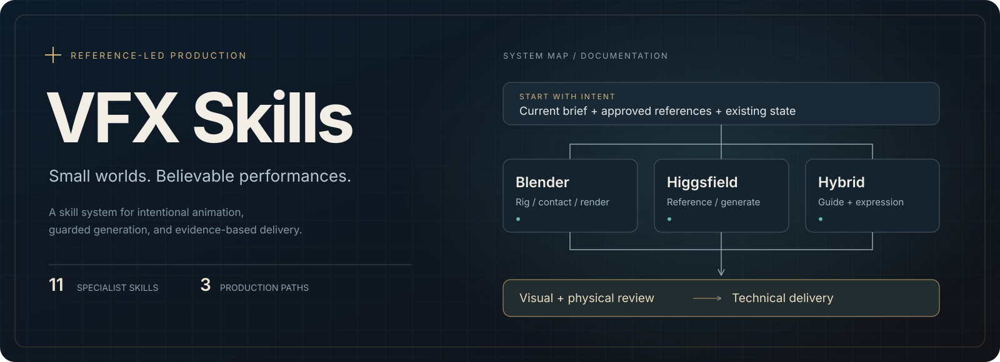
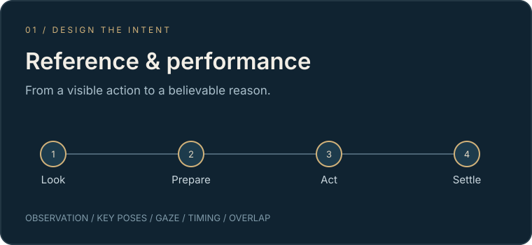
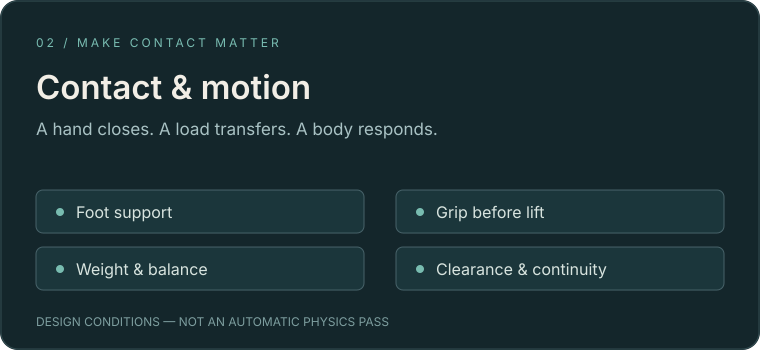
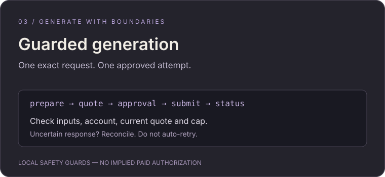
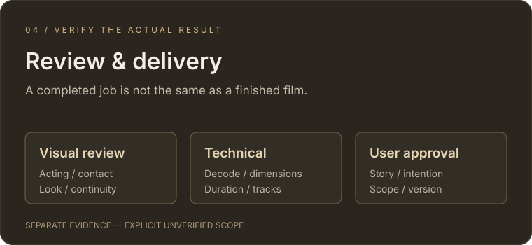
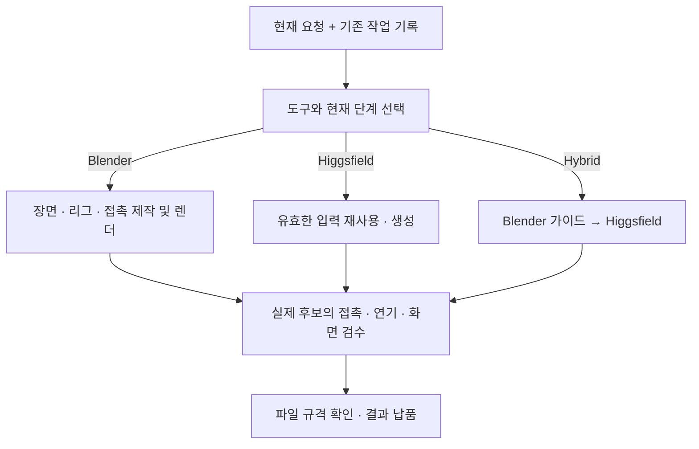

<div align="center">

# VFX Skills

**작은 세계에, 설득력 있는 움직임을.**

레퍼런스의 분위기를 읽고, 캐릭터의 연기를 설계하고,<br>
Blender와 생성형 영상 도구를 연결해 검수 가능한 결과물로 만드는 제작 워크스페이스.

<p>
  
  
  
  
</p>

[시작하기](#quick-start) · [제작 흐름](#workflow) · [스킬 11개](#skills) · [Kimodo 현황](#kimodo) · [실행 가이드](#generation) · [문서](#docs)



<sub>시스템 구성과 책임을 설명하는 문서용 다이어그램입니다. 별도의 제품 GUI를 촬영한 화면이 아닙니다.</sub>

</div>

---

> **이 저장소는 영상 생성 모델이나 물리엔진 자체가 아닙니다.**
> Codex가 읽는 **제작 스킬 11개**, 현재 작업의 **라우팅 설정**, Higgsfield의 유료 제출을 관리하는 **Python 실행기**를 담고 있습니다. 원본 영상·모델·Blender 장면·계정 정보는 로컬에 분리합니다.

## 한눈에 보는 네 가지 역할

<table>
  <tr>
    <td width="50%" valign="top">
      <a href="#skills"></a>
      <h3>의도가 읽히는 연기</h3>
      <p>모션을 나열하기 전에 관찰·감정·시선·키포즈·타이밍을 설계합니다. 전문용어를 실제 화면에서 확인할 행동으로 바꿉니다.</p>
    </td>
    <td width="50%" valign="top">
      <a href="#quality"></a>
      <h3>접촉이 설득력 있는 동작</h3>
      <p>발 지지, 손가락 그립, 하중 전달과 관절 협응을 함께 봅니다. 물리엔진을 사용했다는 사실만으로 자연스러움을 승인하지 않습니다.</p>
    </td>
  </tr>
  <tr>
    <td width="50%" valign="top">
      <a href="#generation"></a>
      <h3>조건이 분명한 생성</h3>
      <p>입력·계정·상한을 확인하고 한 번만 제출합니다. 결과가 불명확하면 자동 재시도하지 않고 기존 작업부터 확인합니다.</p>
    </td>
    <td width="50%" valign="top">
      <a href="#quality"></a>
      <h3>실제 결과로 확인하는 납품</h3>
      <p>생성 완료, 파일 정상, 자연스러움, 사용자 승인을 구분합니다. 어느 버전의 무엇을 확인했는지 근거를 남깁니다.</p>
    </td>
  </tr>
</table>

<a id="overview"></a>

## 어떤 프로젝트인가요?

접시 위의 작은 캐릭터가 재료를 가져오고 함께 요리하며, 테이블 전체가 하나의 무대로 변하는 영상을 만들면서 쌓은 제작 규칙과 도구입니다. 미니어처 다이닝·SURA 테이블 프로젝션을 주요 사례로 삼되, 레퍼런스 기반 캐릭터 애니메이션과 하이브리드 영상 제작에도 활용할 수 있습니다.

목표는 “cinematic, cute, natural”이라는 형용사를 늘리는 것이 아닙니다. **어떤 행동이 왜 일어나고, 무엇이 유지되어야 하며, 실제 출력에서 무엇을 확인할지**를 명확하게 만드는 것입니다.

- 손이 닿기도 전에 들리는 항아리, 바닥을 미끄러지는 발, 접시를 관통하는 캐릭터를 의심합니다.
- 멈추고 다시 시작하는 단계식 동작 대신 준비·반응·겹치는 움직임과 리듬을 설계합니다.
- 소품의 출발점과 도착점, 캐릭터 정체성, 클립 경계의 속도·빛·색을 추적합니다.
- 실제 테이블에 투사할 콘텐츠와 테이블을 촬영하는 광고 영상을 구분합니다.
- 이미 유효한 작업을 재사용하고, 끝없는 재제작 대신 요청한 산출물로 진행합니다.

### 현재 구현된 범위

**사용할 수 있는 기능**

- 스킬 등록, 단계별 라우팅, 메타데이터·로컬 링크 검사.
- 도구 설치 경로 탐색과 공백이 포함된 체크아웃 경로 처리.
- Higgsfield 요청 준비 → 견적 → 승인 기록 → 1회 제출 → 상태 조회.
- 요청·입력 해시 확인, 계정 변경 확인, 동일한 제출 인자에 대한 로컬 중복 시도 방지.
- 미디어 디코딩·규격 검사, 모션 프레이즈 타이밍 등 스킬의 보조 스크립트.
- 기존 스킬 백업 설치, 로컬 경로 이관, 게시 전 파일 검사.

**아직 자동화하지 않은 부분**

- `route`는 필요한 스킬 이름을 반환할 뿐, 스킬을 실행하거나 영상을 생성하지 않습니다.
- Blender 제작·리깅·렌더는 작업별 도구와 스킬로 수행합니다. 공통 CLI에 범용 `render` 명령은 없습니다.
- 결과 다운로드, 영상 확장·편집, 시각적 검수는 공통 실행기에 통합되어 있지 않습니다.
- Kimodo·Unreal의 독립 실행 모듈과 실제 프로젝터 캘리브레이션은 제공하지 않습니다.

<a id="quick-start"></a>

## 빠르게 시작하기

### 1 · 저장소 열기

기존 환경에서는 **`VFX Skills` 폴더**를 엽니다. 새 환경에서는 저장소 접근 권한이 있는 계정으로 클론합니다.

```sh
git clone https://github.com/yc9954/vfx-skills.git "VFX Skills"
cd "VFX Skills"
```

Python **3.10 이상**이 필요합니다. 아래 `python3`가 그 버전을 가리키지 않으면 `python3.12` 등 설치된 명령으로 바꿉니다.

```sh
python3 --version
python3 vfx.py doctor
python3 vfx.py skills validate
```

공통 실행기는 Python 표준 라이브러리만 사용합니다. 기본 경로·스킬 검사는 Blender나 유료 계정 없이 수행할 수 있습니다.

> `doctor`의 경로 발견은 **GPU·인증·렌더 성공 확인이 아닙니다.** 로그인·업로드·렌더·유료 생성도 수행하지 않습니다.

### 2 · Codex에 스킬 연결하기

```sh
# 변경 계획만 확인
python3 tools/install_skills.py

# 확인한 계획대로 등록
python3 tools/install_skills.py --apply
```

기본 등록 위치는 사용자 홈의 `.codex/skills`입니다. 같은 이름의 기존 스킬 11개만 `.local/skill-backups/`에 백업한 뒤, 이 저장소로 심볼릭 링크를 연결합니다. 다른 스킬은 건드리지 않습니다.

진행 중인 턴이 변경된 설명을 즉시 다시 읽는다고 가정하지 말고 **다음 턴이나 새 세션에서** 사용 여부를 확인합니다. 저장소를 이동했다면 설치 명령을 다시 실행하세요.

### 3 · 원하는 결과를 말하기

사용자가 bpy 코드나 모든 제작 단계를 직접 지정할 필요는 없습니다. **레퍼런스, 산출물, 선택한 도구, 반드시 지킬 조건**을 알려주면 됩니다.

```text
$miniature-film-director를 사용해줘.

이 레퍼런스와 기존 프로젝트로 10초짜리 4인 테이블 투사용 영상을 만들어줘.
테이블을 촬영하는 광고가 아니라 테이블 위에 직접 투사할 콘텐츠야.
유효한 기존 레퍼런스와 Blender 가이드가 있으면 재사용하고,
Higgsfield로 생동감을 더해줘. 카메라와 접시 위치를 임의로 바꾸지 말아줘.

이번 요청의 입력 자료와 견적을 먼저 보여줘.
내가 승인한 범위에서만 제출하고, 접촉·연기·화면과 파일 규격을 나누어 검수해줘.
이 메시지 자체는 유료 생성 승인이 아니야.
```

Blender만 원한다면 “AI 생성 없이 편집 가능한 장면과 검수 영상을 만들어줘”라고 명시합니다. 상태 확인이나 기존 영상 분석만 요청받았을 때는 새 생성으로 넘어가지 않습니다.

<details>
<summary><strong>선택 사항: vfx 명령 설치와 필요한 도구</strong></summary>

소스 체크아웃에서 editable 설치를 사용할 수 있습니다.

```sh
python3 -m venv .venv
. .venv/bin/activate
python -m pip install -e .
vfx doctor
```

스킬·설정을 포함한 **소스 체크아웃을 유지하는 방식**입니다. 독립 wheel에 모든 리소스가 포함되는 배포 구조는 아닙니다. 별도 설치 위치에서는 `VFX_SKILLS_ROOT`에 체크아웃 위치를 지정할 수 있습니다.

| 작업 | 추가 요구 사항 |
|---|---|
| 경로·스킬 검사, 라우팅, 공통 테스트 | Python 3.10+ |
| Higgsfield 견적·승인 기록·제출·상태 | 로그인된 `higgsfield` CLI와 네트워크 |
| 미디어 검사와 해당 테스트 | `ffmpeg`, `ffprobe` |
| Blender 장면·리그·렌더 | 별도 Blender 설치와 해당 작업의 자산 |
| 게시 전 검사와 버전 관리 | Git |
| 기존 macOS 셸 스크립트 경로 이관 | macOS의 `zsh` |

`VFX_BLENDER`는 `doctor`에서 Blender 경로를 명시할 때 사용합니다. 렌더 장치를 GPU로 전환하는 옵션은 아닙니다.

</details>

<a id="workflow"></a>

## 제작 흐름



이것은 **제작 책임의 흐름**입니다. CLI가 모든 단계를 자동 실행한다는 뜻은 아닙니다. 레퍼런스·연기·인체·음식 지식은 해당 단계에서 필요한 만큼 적용합니다.

| 경로 | 선택하는 상황 | 유지할 원칙 |
|---|---|---|
| **Blender** | 편집 가능한 3D 장면과 정밀한 접촉·그립이 필요 | 실제 기하·지지·제어를 확인하고 AI 생성을 임의로 추가하지 않기 |
| **Higgsfield** | 유효한 레퍼런스가 있고 생성 영상으로 표현을 완성 | 불필요한 Blender 재제작 없이 실제 생성·회수로 진행하기 |
| **Hybrid** | 배치·동작은 가이드로 잡고 허용한 표현을 확장 | 고정할 조건과 모델에 맡길 조건을 분리하기 |

### 필요한 단계만 선택

```sh
python3 vfx.py route higgsfield generate
python3 vfx.py route blender build --specialist human_motion
python3 vfx.py route hybrid prompt --specialist acting --specialist food
```

첫 명령은 아래처럼 **선택 결과만** 반환합니다.

```json
{
  "backend": "higgsfield",
  "stage": "generate",
  "skills": ["blender-seedance-handoff"]
}
```

지원 단계는 경로마다 다릅니다. `higgsfield build`처럼 정의되지 않은 조합은 다른 경로로 바뀌지 않고 오류를 반환합니다. [workflow.json](config/workflow.json)이 정확한 목록입니다.

### 바뀐 부분만 다시 제작

인코딩 수정 때문에 모션을 재생성하지 않습니다. 유효한 가이드가 있는데 플러그인 시험만 반복하지 않습니다. 불변이 확인된 근거는 재사용하되, 변경의 영향을 받는 접촉·화면·출력은 다시 확인합니다. 전체 영상을 요청받았다면 가이드나 시험편만 만든 상태를 완료라고 보고하지 않습니다.

<a id="skills"></a>

## 11개의 제작 스킬

스킬은 모든 작업에서 순서대로 실행하는 체크리스트가 아닙니다. **현재 단계의 담당 스킬과 필요한 전문 지식만** 읽습니다.

| 역할 | 스킬 | 주요 책임 |
|---|---|---|
| 제작 감독 | [miniature-film-director](skills/miniature-film-director/SKILL.md) | 요청 범위, 산출물, 단계 인계와 재개 |
| 레퍼런스 분석 | [film-reference-breakdown](skills/film-reference-breakdown/SKILL.md) | 시간별 행동·소품·접촉·질감 관찰과 추론 구분 |
| 이미지 연출 | [visual-image](skills/visual-image/SKILL.md) | 캐릭터·재질·미술 기준과 비교 이미지 방향 |
| 영상 연출 | [visual-video](skills/visual-video/SKILL.md) | 카메라·조명·편집·CG를 관찰 가능한 지시로 변환 |
| 캐릭터 연기 | [character-performance-animation](skills/character-performance-animation/SKILL.md) | 의도·감정·시선·키포즈·타이밍·후속 움직임 |
| 인체 움직임 | [human-motion-biomechanics](skills/human-motion-biomechanics/SKILL.md) | 관절 가동 범위, 그립, 하중, 체중 이동과 균형 |
| 음식·유체 | [food-vfx-director](skills/food-vfx-director/SKILL.md) | 붓기·끓기·점도·증기·재료 스케일과 물성 |
| 3D 동작 제작 | [blender-contact-animation](skills/blender-contact-animation/SKILL.md) | 리그·보행·접촉·소품 상호작용, 조건부 Kimodo 활용 |
| 생성 모델 전달 | [blender-seedance-handoff](skills/blender-seedance-handoff/SKILL.md) | 가이드·레퍼런스·프롬프트를 지원 입력과 예산에 연결 |
| 자연스러움 검수 | [animation-causality-review](skills/animation-causality-review/SKILL.md) | 순간 등장·관통·미끄러짐·연속성·연기 결함 검토 |
| 렌더·납품 | [film-render-delivery](skills/film-render-delivery/SKILL.md) | 승인된 렌더 실행, 진행 확인, 인코딩·기술 검증 |

각 스킬의 `SKILL.md`는 진입점입니다. 상세 지식은 `references/`, 서식은 `assets/`, 보조 코드는 `scripts/`에 둡니다. 모든 스킬이 이 폴더를 전부 가지는 것은 아닙니다.

### “가능한 움직임”과 “살아 있는 연기”는 다릅니다

항아리를 드는 장면은 `잡기 → 들기 → 붓기 → 내려놓기`만으로 충분하지 않습니다.

> 항아리를 본다 → 상대와 시선을 맞춘다 → 발과 몸통을 준비한다 → 그립을 만든다 → 하중을 받으며 들어 올린다 → 붓는 동안 상대가 반응한다 → 항아리가 안정되고 몸과 소매가 서로 다른 타이밍에 멈춘다.

연기 스킬은 의도와 리듬을, 인체·접촉 스킬은 가능한 조건을 설계합니다. 검수 스킬은 **실제 출력에서 둘 다 유지되는지** 확인합니다. 용어를 프롬프트에 넣었다는 사실은 통과 근거가 아닙니다.

<a id="structure"></a>

## 저장소 구조와 기록

```text
VFX Skills/
├── README.md                      # 시작점과 현재 지원 범위
├── AGENTS.md                      # 에이전트 작업 규칙
├── NOTICE.md                      # 출처와 라이선스 경계
├── vfx.py                         # 소스 체크아웃용 진입점
├── pyproject.toml
├── config/workflow.json           # 경로·단계·전문 스킬 매핑
├── src/vfx_skills/
│   ├── runtime.py                 # 경로, 해시, 원자적 JSON 기록
│   ├── catalog.py                 # 스킬 검사, 라우팅, 도구 탐색
│   ├── jobs.py                    # Higgsfield 요청·승인·1회 제출
│   └── cli.py                     # 명령 인터페이스
├── skills/                        # 스킬 11개와 참조·보조 코드
├── examples/                      # 개인정보 없는 설정 예시
├── tests/                         # 오프라인 회귀 테스트
├── tools/                         # 설치·이관·정리·게시 전 검사
├── docs/                          # 운영 문서와 README 시각 자료
└── .local/                        # Git 제외 — 필요할 때 생성
    ├── legacy/                    # 기존 로컬 제작 프로젝트·원본
    ├── requests/                  # 편집 중인 생성 요청
    ├── runs/                      # 요청·견적·승인·제출 영수증
    ├── attempts/                  # 같은 제출 인자의 시도 기록
    ├── skill-backups/             # 스킬 설치 전 백업
    ├── path-migration/            # 경로 변경 원본과 이관 기록
    └── cleanup/                   # 복구 가능한 정리 기록
```

### 한 프로젝트에는 하나의 작업 기록

기존 `film_state.json`이나 같은 역할의 장부를 재사용합니다. 공통 CLI가 별도 프로젝트 DB를 만들거나 기존 기록을 자동 동기화하지는 않습니다.

- **프로젝트 기록:** 요청, 장면·후보 버전, 검사, 사용자 결정, 남은 문제와 다음 행동.
- **실행 영수증:** 개별 요청의 해시, 견적, 승인 출처, 제출 시도, 작업 ID와 응답.

프로젝트 기록의 `runs`에서 실행 영수증을 참조합니다. 새 기록이 정말 필요할 때만 [film-state.template.json](skills/miniature-film-director/assets/film-state.template.json)을 사용합니다. 상세한 인계 기준은 [공통 인계 규약](skills/miniature-film-director/references/handoff-contract.md)을 참고하세요.

<a id="generation"></a>

## Higgsfield 실행과 비용 관리

공통 실행기는 **이미 업로드된 미디어 UUID**를 사용합니다. 준비 단계에서 파일을 자동 업로드하지 않으며, 유료 생성은 `submit --execute`에서만 시도합니다.

| 명령 | 하는 일 | 외부 서비스 / 변경 |
|---|---|---|
| `job prepare` | 요청 검증, 입력 경로 정리, 해시 저장 | 오프라인 / 로컬 기록 생성 |
| `job quote` | 현재 모델 정보·견적 조회 | 조회 / 로컬 견적 갱신 |
| `job approve` | 실제 승인 출처·상한·계정 해시 기록 | 견적·계정 조회 / 승인 기록 생성 |
| `job submit --execute` | 최신 조건 확인 후 1회 생성 시도 | **유료 생성 가능** / 시도 기록 생성 |
| `job status` | 기존 시도와 확인 가능한 작업 상태 조회 | 작업 ID가 있으면 조회 / 로컬 기록 수정 없음 |

> **`approve`는 허가를 만드는 명령이 아닙니다.** 실제 사용자의 승인을 기록할 뿐입니다. 과거 승인을 새 요청에 복사하거나 예시의 상한을 상시 예산으로 사용하면 안 됩니다.

<details>
<summary><strong>실행 예제 — 실제 사용자 승인 없이는 제출하지 마세요</strong></summary>

#### 1. 요청 파일 준비

```sh
mkdir -p .local/requests
cp examples/generation-request.json .local/requests/shot.json
```

복사한 파일의 프롬프트·설정·미디어 UUID를 수정합니다. `REPLACE_WITH_EXISTING_UPLOAD_UUID`는 그대로 실행되지 않는 자리표시자입니다. 모델·모드·길이·가격은 현재 서비스에서 확인합니다.

```sh
higgsfield model get seedance_2_5 --json
```

- 전달 가능한 설정: `prompt`, `mode`, `duration`, `resolution`, `aspect_ratio`, `generate_audio`.
- 미디어 플래그: `image-references`, `video-references`, `audio-references`, `start-image`, `end-image`.
- 전달 가능과 선택한 모델의 실제 조합 지원은 다릅니다. 예시 파일은 보장된 프리셋이 아닙니다.
- 선택적 `local_inputs`에는 원본의 `path`, `sha256`을 기록합니다. 이는 업로드 명령이 아니며 서버 UUID와 원본의 동일성을 자동 입증하지 않습니다.
- `delivery`는 납품 목표 메타데이터입니다. 모델 설정이나 자동 편집 명령이 아닙니다.

#### 2. 준비와 견적

```sh
python3 vfx.py job prepare shot-01 .local/requests/shot.json
python3 vfx.py job quote shot-01
```

같은 run 이름을 덮어쓰지 않습니다. 준비된 요청이 바뀌면 새 요청과 그에 맞는 승인이 필요합니다.

#### 3. 승인 기록과 제출

**이번 정확한 요청에 대해 사용자가 승인한 경우에만** 실행합니다. 아래 `100`은 설명용 예시이지 승인된 예산이 아닙니다.

```sh
python3 vfx.py job approve shot-01 \
  --cap 100 \
  --source "이번 입력·계정·상한·1회 생성에 대한 실제 승인 메시지와 맥락"

python3 vfx.py job submit shot-01 --execute
python3 vfx.py job status shot-01
```

요청·입력 해시·최신 견적·계정·잔액을 재확인하고, 실제 생성 호출 **이전**에 시도 기록을 만듭니다. 확인한 서비스 응답으로 실제 출력을 회수한 뒤 검수합니다. 공통 CLI에는 자동 다운로드나 extension 명령이 아직 없습니다.

</details>

### 응답이 불명확할 때

제출 중 연결이 끊기면 서비스에서 작업이 시작됐을 수도 있습니다. `submission_uncertain` 기록을 유지하고 기존 작업·히스토리·차감부터 확인합니다. 파일을 지우거나 run 이름만 바꿔 재시도하지 않으며, 실패했다고 환불을 가정하지 않습니다. `actual_charged`는 실제 청구 근거로 확인하기 전까지 미확정입니다.

이것은 **로컬 중복 시도 방지**이지 분산 잠금·서비스 자체 멱등성·계정 전체 예산 관리가 아닙니다. 상세한 경계는 [생성 실행 가이드](docs/generation.md)에 있습니다.

<a id="quality"></a>

## 완료를 판단하는 세 가지 기준

### 01 · 행동과 화면

실제 후보에서 그립·발 지지·관통·소품의 연속성을 봅니다. 시선, 준비 동작, 상대의 반응, 속도와 멈춤의 타이밍도 별도로 확인합니다. 물리 수치가 맞는 것과 매력적인 연기는 다른 판단입니다.

### 02 · 기술 파일

전체 디코딩, 프레임 수, 길이, 해상도, 평균 FPS, 오디오 트랙 유무와 파일 변경 여부를 확인합니다. 평균 FPS만으로 고정 프레임레이트를 증명하거나 오디오가 있다는 이유로 음질을 승인하지 않습니다.

### 03 · 사용자 의도

이야기·미술·질감·투사 구도가 의도에 맞는지 확인합니다. “계속 진행해”라는 작업 허가를 자연스러움에 대한 품질 승인으로 바꾸지 않습니다.

<details>
<summary><strong>로컬 영상의 기술 검증 예제</strong></summary>

아래는 10초·1920×1080·30fps·오디오 포함 영상의 **예시 규격**입니다. 실제 납품 목표에 맞춰 기대값을 바꿉니다.

```sh
python3 skills/film-render-delivery/scripts/media_receipt.py \
  .local/output/final.mp4 \
  --expect-seconds 10 --expect-fps 30 --expect-frames 300 \
  --expect-width 1920 --expect-height 1080 --audio required
```

`--receipt`로 새 JSON 파일에 저장할 수 있습니다. 상위 폴더가 있어야 하며 기존 영수증은 덮어쓰지 않습니다. 원본 영상은 변경하지 않습니다. 기술 검사를 통과해도 연기·접촉·재질·음질은 별도 검수 대상입니다.

</details>

### 테이블 프로젝션에서는

- 투사할 콘텐츠와 테이블을 촬영하는 광고를 구분합니다.
- 접시·배경·캐릭터의 좌표와 관객 방향을 제작 조건으로 명시합니다.
- 이 시리즈의 배경은 접시 아래까지 이어져야 하며, 의도하지 않은 빈 고리를 만들지 않습니다.
- 캐릭터 가독성과 실제 접시 정렬은 각각 확인합니다.
- 테이블·접시·프로젝터를 측정하지 않았다면 현장 정렬이 완료된 마스터라고 주장하지 않습니다.

[프로젝션 연출 기준](skills/miniature-film-director/references/projection-art-direction.md)은 이 프로젝트의 기준이며 모든 영상에 강제할 보편 규칙은 아닙니다.

<a id="kimodo"></a>

## Kimodo의 현재 위치

**Kimodo는 보존되어 있지만 새 CLI의 독립 모듈로 통합되지는 않았습니다.** 저장소를 클론하는 것만으로 생성 환경이 준비되지는 않습니다.

**GitHub에 포함된 내용**

- [기능과 역할 분담](skills/blender-contact-animation/references/kimodo-capabilities.md): 생성·제약·후처리 선택과 Blender가 마무리할 부분.
- [연속 동작 설계](skills/blender-contact-animation/references/kimodo-continuity.md): 멈칫거림, 클립 경계, 끝 자세 이력과 다음 동작의 연결.
- `blender-contact-animation`이 필요한 상황에서 해당 자료를 읽도록 하는 연결.

**기존 작업 머신에만 보존된 데이터**

```text
.local/legacy/kimodo/             Kimodo 소스
.local/legacy/kimodo.gitbundle    기존 Git 번들
.local/legacy/pipeline/hfcache/   모델 캐시·가중치
.local/legacy/pipeline/motion/    NPZ·BVH 등 기존 모션
.local/legacy/pipeline/           생성·변환·리타깃·렌더 실험 코드
```

관련 실행 스크립트의 로컬 경로는 이관했지만, **새 구조에서 모델 로드 → 모션 생성 → Blender 전달을 다시 실행한 검증은 아직 하지 않았습니다.** Unreal도 기존 로컬 실험 프로젝트를 보존한 상태이며 공통 실행 경로에는 없습니다.

다음 통합에서는 외부 설치·버전·라이선스·가중치 설정, 재현 가능한 실행 모듈, 좌표·단위·접촉·경계 품질 검증을 다뤄야 합니다. 이는 남은 과제이지 현재 구현 기능이 아닙니다.

<a id="safety"></a>

## 데이터·경로·복구 정책

### 소스는 Git에, 제작 데이터는 로컬에

코드·스킬·설정·문서만 버전 관리합니다. API 키, 토큰, Notion 원문, 사용자 레퍼런스, 유료 생성 결과, `.blend`·FBX·영상, 가중치, 렌더 프레임과 거대 로그는 제외합니다. **Private 저장소도 비밀정보 보관함이 아닙니다.**

```sh
python3 tools/check_publish.py
```

위 검사는 **Git 인덱스에 실제로 올라갈 파일**의 경로, 알려진 비밀정보 패턴, 바이너리, 5MiB 초과 파일, 심볼릭 링크·서브모듈을 확인합니다. 모든 비밀을 찾아내는 완전한 보안 감사는 아닙니다.

### 공백이 있는 폴더와 이동

새 코드는 스크립트·설정 위치를 기준으로 경로를 찾고 외부 도구를 인자 배열로 호출합니다. 내부 입력은 상대경로로 저장하므로 체크아웃을 통째로 옮겨도 요청 해시를 유지할 수 있습니다. 외부 입력은 절대경로가 유지되며, 그 파일까지 이동하면 새 요청·승인 검토가 필요합니다.

스킬 링크는 저장소 이동 후 재등록합니다. 옛 `kimodo` 경로는 기존 머신의 `.local/legacy`를 가리키는 호환 링크로 남겼으며 새 작업의 시작점은 `VFX Skills`입니다. 호환 링크만으로 모든 과거 프로젝트의 이식성이 증명되지는 않습니다.

### 복구할 수 있는 정리

원본 자산·모션·장면·가중치·이력은 보존합니다. 중간 파일은 대체 결과와 사용 중인 프로세스를 확인한 뒤 정확한 목록으로 정리합니다. 휴지통 이동과 로컬 영수증을 사용하며 **휴지통을 비우기 전에는 디스크 공간이 확보되지 않습니다.** 과거 보고서·승인 해시·Blender 내부 참조를 무작정 치환하지 않습니다.

상세 도구와 복구 기준은 [마이그레이션 안내](docs/migration.md)에 있습니다. 유지보수 명령은 일반 생성 과정에서 자동으로 실행하지 않습니다.

<a id="testing"></a>

## 테스트와 검증 범위

```sh
# 공통 실행기·경로·게시 검사
python3 -m unittest discover -s tests -v

# 스킬 등록 정보와 로컬 링크
python3 vfx.py skills validate

# 모션 프레이즈 타이밍
python3 skills/blender-contact-animation/scripts/test_phrase_timing.py

# 기술 미디어 검사 — ffmpeg/ffprobe 필요
python3 skills/film-render-delivery/scripts/test_media_receipt.py
```

**2026-09-30 로컬 확인 기준:** 공통 22개 + 프레이즈 11개 + 미디어 10개 = **43개 통과**. 스킬 11개의 메타데이터·링크 검사도 통과했습니다. 이 숫자는 해당 시점의 기록이며 동적으로 갱신되는 CI 배지가 아닙니다.

검증 범위에는 공백 경로·다른 작업 디렉터리·체크아웃 이동, 요청·계정 변경, 견적 상승, 잘못된 입력, 중복 시도, 불명확한 제출과 중단된 시도 기록이 포함됩니다.

유료 API는 모킹합니다. **실제 유료 생성·GPU 렌더·Kimodo 추론·시각적 품질을 이 테스트로 검증한 것은 아닙니다.** Blender 전용 관절 감사 테스트도 별도 환경이 필요하며 위 43개에 포함되지 않습니다.

GitHub Actions는 현재 미등록입니다. 게시 계정에 `workflow` 권한이 없어 [CI 템플릿](tools/ci.template.yml)만 보관했습니다. Python 3.10/3.12 매트릭스는 실행 계획이지 CI 통과 기록이 아닙니다. 실제 등록 시 권한과 `.gitignore`·게시 허용 경로를 함께 검토해야 합니다.

<a id="faq"></a>

## 자주 묻는 질문

<details>
<summary><strong>왜 모든 작업을 Blender로 만들지 않나요?</strong></summary>

정밀한 기하·그립·접촉과 생성형 표현은 필요한 제어 수준이 다릅니다. 사용자가 선택한 도구와 산출물이 우선이며, 유효한 가이드가 있으면 재사용합니다. 하나의 방식만 강요하지 않습니다.

</details>

<details>
<summary><strong>Higgsfield가 자연스러움과 물리를 알아서 해결하나요?</strong></summary>

아닙니다. 가이드의 손·물체·빛·속도를 바꿀 수 있습니다. 고정할 조건과 허용할 표현을 구분하고 실제 후보를 검수해야 합니다. 생성 성공은 품질 통과가 아닙니다.

</details>

<details>
<summary><strong>스킬을 설치하면 자동으로 영상이 만들어지나요?</strong></summary>

스킬은 에이전트가 읽고 따르는 지침입니다. 실제 도구·파일·인증과 현재 작업 권한이 필요합니다. 스킬 호출만으로 유료 생성이나 자료 업로드가 승인되지는 않습니다.

</details>

<details>
<summary><strong>다른 컴퓨터에서 클론하면 무엇이 빠져 있나요?</strong></summary>

원본 영상·모델·장면, Kimodo 가중치, `.local` 이력, 도구 설치와 인증 세션이 빠져 있습니다. 이 저장소는 제작 자산 백업이 아닙니다. 사용 권한이 있는 자료와 현재 계정 환경을 별도로 연결하세요.

</details>

<a id="docs"></a>

## 문서와 출처

- [아키텍처](docs/architecture.md) — 책임 분리, 재사용, 실행과 검수의 경계.
- [생성 실행 가이드](docs/generation.md) — 요청·승인·비용과 불명확한 제출 처리.
- [마이그레이션 안내](docs/migration.md) — 폴더 이동, 경로 수정, 보존과 복구.
- [에이전트 작업 규칙](AGENTS.md) — 이 저장소에서 지킬 운영 원칙.
- [프로젝트 예시](examples/project.json) · [생성 요청 예시](examples/generation-request.json).

`visual-image`와 `visual-video`는 Serge Shima의 [smixs/visual-skills](https://github.com/smixs/visual-skills)를 바탕으로 프로젝트에 맞게 조정했습니다. 각 스킬의 CC BY 4.0 `LICENSE`, `NOTICE`, `SOURCE.md`를 보존합니다.

나머지 로컬 스킬·코드에 저장소 전체를 포괄하는 새 오픈소스 라이선스를 부여하지 않았습니다. 영상·모델·음악·모션·레퍼런스의 사용 및 재배포 권리는 개별 확인이 필요합니다. [NOTICE.md](NOTICE.md)를 참고하세요.

---

<div align="center">

**관찰하고 · 설계하고 · 제작하고 · 실제 결과로 검증합니다.**

[맨 위로](#vfx-skills)

</div>
